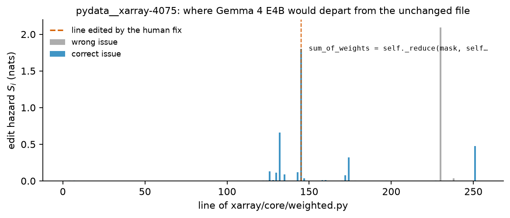
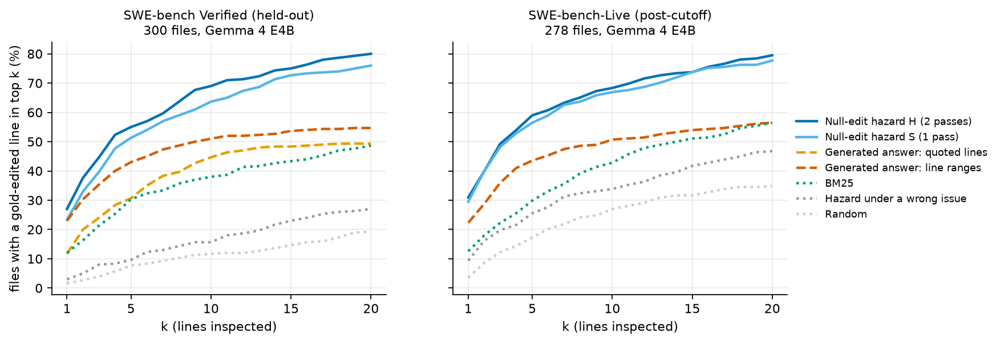
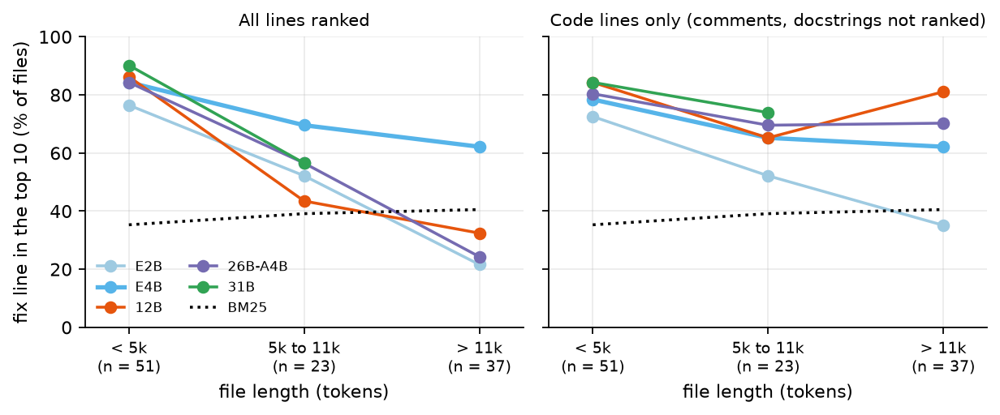

# The Null Edit

## Reading where a small model wants to change code, without letting it write

> DRAFT — numbers marked `[[...]]` are placeholders until the corresponding run finishes. Nothing
> in a placeholder may be cited as a result.

### Abstract

Coding agents make small models *write* to find out what they think. We show that Gemma 4
reveals where it would edit a file before it writes anything. **Null-edit teacher forcing**
asks the model to rewrite a file so that an issue is fixed, then scores the unchanged file as
its answer; one forward pass yields the exact distribution of where a sampled rewrite would first
depart from the original. On 300 held-out files of SWE-bench Verified, the resulting per-line
*edit hazard* (the "map") of Gemma 4 E4B — no fine-tuning, generation, tests or tools — puts a
line of the human fix in its top ten for 69% of files, against 38% for BM25 and 51% when the same
model is asked for line ranges. Asking names the right function first
more often (60% vs 50%); the map is better after that, and the two combine: an
agent that asks for the function and then reads 5% of the file in map order sees a line of the
fix in 71% of files (asking alone: 64%). The map falls to near chance under a wrong issue (16%), holds on
issues created after the model's training cutoff (68% vs 43% for BM25), and still localizes the
fix in files that greedy rewriting would leave unchanged. Larger models are not better out of the box: 12B and 26B A4B spend their hazard on comments and
docstrings; ranking code lines only lifts both by 27 points on fresh issues (pre-registered), level
with E4B. Community
4-bit weights lose 12 points to bf16. Code, per-token logs and the pre-registration are released.

### 1. Introduction

A coding agent built on a small local model spends its budget *writing*: plans, tool calls,
patches. This paper describes a tool call that writes nothing and tells the agent where to read.

We study one probe. Give the model an issue and a source file, ask it to rewrite the file so that
the issue is fixed — and then, instead of sampling, feed it the **unchanged file** as its own
answer. At every token the model reports how much probability it puts on *not* writing what is
already there. This is the verification pass of speculative editing [8, 9]. We keep every
probability and ask what it measures.

It measures something exact (§2): the distribution of *where the model's rewrite would first
depart from the original*.

**Contributions.**

1. *An instrument.* Null-edit teacher forcing turns any causal LM into a line-level "where would
   you edit?" map with no generation, training, tools or line numbers (Figure 1).
2. *A pre-registered evaluation* on 300 held-out SWE-bench Verified files with Gemma 4 E4B. The
   map beats BM25 on lines at every cut-off. Against the model's own generated answer it loses at
   the first function, ties at the first line, and wins from the fifth of either.
3. *A below-threshold finding.* In files where greedy rewriting makes no change, the same forward
   pass still localizes the fix.
4. *Controls and scope*: wrong issue, instruction controls, post-cutoff issues,
   the other Gemma 4 sizes (with a pre-registered repair for the larger ones), and 4-bit versus
   bf16 weights.
5. *Agent-facing uses*: a reading recipe (ask for the function, read in map order),
   and *two negative results*: fed back as a hint, the map leaves the accuracy of the model's
   own edit unchanged; without the file in context, likelihood shifts are no better than BM25.



**Figure 1.** Edit hazard per line of one held-out file under the right issue (blue) and a wrong
issue (grey). Dashed: the line the human fix edits.

### 2. Method

**Setup.** Let *x = x₁…x_T* be the tokens of a source file and *c* a prompt containing an issue,
the file, and the instruction *"Rewrite `<path>` so that the issue is fixed. Output the complete
file, changing only what is necessary."* The model π defines a rewrite policy π(y | c).

**Null-edit teacher forcing.** Run π once on *c* followed by *x* itself — the answer opened, in
every run, with a ```` ```python ```` fence — and record *p_t = π(x_t | c, x_<t)*.

**First-edit identity.** Let τ be the first position at which a rewrite sampled from π (temperature 1,
no truncation) differs from *x*. Then

  P(τ = t) = (1 − p_t) · ∏_{s<t} p_s,  P(no edit) = ∏_t p_t.

*Proof.* A sample agrees with *x* before *t* with probability ∏_{s<t} p_s; given that, its prefix
*is* x_<t, so it deviates at *t* with probability 1 − p_t. ∎

The identity is elementary; it makes exact, after one pass, a quantity usually estimated by
sampling rewrites.

**Edit hazard.** For line *i* we define

  S_i = − Σ_{t ∈ line i} log p_t,

so 1 − e^{−S_i} is the probability of editing line *i* given that everything before it was kept.
Lines are ranked by S_i; a function's score is the sum over its lines; the file total
S = −log P(no edit).

**Issue-specific hazard.** Some lines are simply hard to copy. We rerun the same prompt with a
*wrong* issue (same repository, disjoint files, similar length) and keep the excess:
H_i = Σ_{t∈i} max(0, log p_t^{wrong} − log p_t). S costs one pass, H two.

### 3. Experimental setup

**Models and hardware.** All five instruction-tuned Gemma 4 checkpoints (31B: files up to 11,000 tokens only), thinking
disabled, no fine-tuning. Two arms are kept separate throughout:

| Arm | Machine | Software, weights | Used for |
|---|---|---|---|
| **MAC** | Apple M5 Max laptop, 64 GB | MLX, community 4-bit builds | development set, every design choice, and results marked MAC |
| **DGX** | NVIDIA DGX Spark, 121 GB | PyTorch/transformers, official bf16 weights | every held-out number below, unless marked MAC |

**Data.** *Verified*: SWE-bench Verified [1, 2]. Every 20th instance (25) is the development
set; the other 475 were shuffled once and evaluated in that order (first 250; first 100 for the
size comparison and controls). *Live*: SWE-bench-Live [3] issues created on or after 2025-03-01,
at most three per repository. Gemma 4's model card states a training-data "cutoff date of January
2025" [16]. We score every non-test Python file touched by the human ("gold") patch, at the
pre-fix commit, if it has ≤ 32k tokens (300 of 317 Verified files).

**Labels and metrics.** Gold lines are original-file lines the gold patch removes or modifies; a
pure insertion is represented by its two neighbouring lines. Function units are outermost
functions and methods; the remaining module- and class-level lines form "gap" units that are
ranked like functions. We report the rank of the best-ranked gold line (unit) within its file;
hit@k is the share of files with rank ≤ k. Intervals and paired tests use 10,000
instance-clustered bootstrap resamples.

**Baselines on the same files.** BM25 between issue and line/function; random; and
*asking the model*: the same model reads the same issue and file and (i) generates line ranges
over a numbered file (pre-registered), (ii) quotes the lines that must change (not
pre-registered; aligned post hoc in its favour, 36% → 45% at top ten), or (iii) *writes the fix* as a search/replace edit. All three were run after the map's
held-out scores were known.

**Controls.** Wrong issue; right issue with the instruction changed to "print the file
unchanged"; no issue.

**Pre-registration.** Primary score (H), secondary score (S), aggregation and metrics were
written to `HYPOTHESES.md` before any held-out file was scored. Deviations: the file cap was
raised from 20k to 32k tokens (≤ 20k subset: H 71% vs BM25 39%); analyses marked *post hoc*
were added afterwards.

### 4. Results

**4.1 The map finds the edit (Table 1, Figure 2).** With Gemma 4 E4B, a gold line is the single
highest-hazard line of its file (median 587 non-blank lines) in 27% of files and in the top ten in 69%;
its median rank is 4. BM25 reaches 38% (line length: 17%), the model's line-range answer 51% and its quoted answer 45%
(H leads by 31.0 [21, 40], 18.0 [12, 24] and 24.3 [19, 30] points; all Holm-adjusted p < 0.01). One pass (S) gives 64%. The
advantage holds for pure insertions (55% vs 18% for BM25), with every issue weighted equally
(70% vs 33%), and when issues that quote a gold line are removed (67% vs 35%).

**Table 1. Held-out SWE-bench Verified, Gemma 4 E4B, DGX arm: 300 files, 240 issues. hit@k (%),
95% CI on the headline column.**

| Method | Line @1 | @5 | @10 | Function @1 | @3 | @5 |
|---|---|---|---|---|---|---|
| Null-edit H (2 passes) | 27 | 55 | **69** [64, 74] | 50 | 75 | **84** |
| Null-edit S (1 pass) | 23 | 51 | 64 [58, 70] | 44 | 72 | 81 |
| Asked: line ranges (pre-registered) | 23 | 43 | 51 [44, 58] | **60** | 74 | 75 |
| Asked: quoted lines | 12 | 31 | 45 [38, 51] | 51 | 62 | 62 |
| BM25 | 12 | 30 | 38 [29, 47] | 38 | 62 | 71 |
| Wrong issue (control) | 3 | 10 | 16 [11, 21] | 19 | 35 | 44 |



**Figure 2.** Files with a gold-edited line among the top *k* lines. Left: held-out Verified.
Right: post-cutoff Live.

**4.2 Where asking wins.** The line-range answer names a gold *function* first in 60% of files,
the map in 50% (−9.3 [−15, −4]); the quoted answer ties the map (51%). At the top line the two
are tied (27% vs 23%). The answer commits to one or two functions and then stops helping
(75% at top-5); the map keeps ranking (84%; +9.3 [5, 14]). The two combine: ranking lines by H
inside the first three functions the answer names lifts line top-1 from 27% to 33%
(+6.0 [3, 9]; exploratory). H's margin over BM25 at function top-1 is modest (+12 [2, 22]; not significant after Holm
correction).

**4.3 Below the decoding threshold (*post hoc*).** In 84 of the 300 files (73 issues) every
original token has probability ≥ 0.5, so greedy decoding from the fence reproduces the file: a
speculative editor, which sees only where greedy decoding diverges, would change nothing.
(Only from the fence: answering freely, 4-bit E4B on the MAC arm opened with prose in all 84;
pre-declared check.) The one-pass map from that same forward pass still
puts a gold line in its top ten for 54% [42, 65] of these files (H: 64%), against 38% for BM25
and 39% for either generated answer; on Live, 50% (BM25 39%). The model is not silent, though: asked directly, it names the gold function first in 55%
of these files, and under sampling it would edit two files in three (median P(no edit) = 0.32).

**4.4 It is the issue, and the instruction.** Under a wrong issue the same prompt puts 3.9% of
its hazard within two lines of a gold line — the chance share (3.8%); under the right issue,
28.5%, and the median file's total hazard S rises from 1.4 to 5.0 nats. Two more controls on the first 100 issues (111 files, where S reaches 74%) separate the
ingredients. With no issue and the instruction to print the file unchanged, the hazard still
finds the fix in 23% of files (random 12%), consistent with buggy lines being "unnatural"
[10]. The right issue with the same copy instruction gives 35%, no better than BM25 (38%). Only
the instruction to fix lifts it to 74% (+38.7 [29, 48]). We had predicted chance level for both
controls; they are above it, and far below the probe.
The wrong-issue control rules out file and prompt artefacts; it cannot rule out memorised
issue→fix pairs [17]. 

**4.5 After the training cutoff.** On 278 files from 145 SWE-bench-Live issues created between
March and August 2025 (91 repositories, 89 of them absent from SWE-bench Verified), the picture is the
same: H 68% [62, 75] and S 67% at line top-ten against 43% for BM25 and 34% under a wrong issue;
at function top-1, H 63% against 48% (+15 [7, 23]). Files here are smaller, so all methods,
including random (27%), score higher; the comparison is within-set. `[[asking on Live]]`

**4.6 Larger Gemma 4 models: the hazard drifts to prose (Figure 3).** On the 111 files of the
first 100 held-out issues, bigger is not better (we had predicted the opposite): S finds the fix
in the top ten for 53% (E2B), 74% (E4B), 59% (12B) and 59% (26B A4B, a mixture-of-experts model).
Memory limited 31B to files up to 11,000 tokens: on those 74 it reaches 80%, as does E4B. Under 5,000 tokens the sizes are close (76–86%); over 11,000 only E4B stays above BM25
(62%; BM25 41%; the others 22–32%). In those long files a median 90% of the hazard of 12B and
26B A4B sits on comment and docstring lines (31% of lines; E4B 11%); under a *wrong*
issue, the ten 12B tokens we inspected were all in docstrings, comments and help strings (MAC arm). Ranking only code lines lifts 12B from 59% to 79% and 26B A4B from 59% to 75% (E4B
74% → 70%). Because we found this by inspecting these files, we froze the rule and pre-registered
a test on 100 further issues that neither model had scored (113 files). It holds: 12B rises from
42% to 69% (+27.4 [19, 36]) and 26B A4B from 39% to 66% (+27.4 [20, 36]), level with E4B on the
same files (65%). A laptop replication (12B 4-bit, 69 files) agrees: 41% → 57%.
`[[asked at each size]]`



**Figure 3.** Files with a gold line in the top ten of the one-pass map, by file length and
model size (held-out issues 1–100; 31B up to 11,000 tokens). Left: all lines ranked. Right: code
lines only.

**4.7 Quantization blunts the probe.** The MAC arm's community 4-bit weights, loaded into the
DGX code (98 files), reproduce the laptop's line-level numbers (H top-ten 63.7% vs 64.8% on 91
shared files) and score 12.2 points [5.0, 20.2] below bf16 on the same files (63.3% vs 75.5%):
the loss is mostly in the weights, not the software. At 4 bits the map still beats BM25 on lines
(+25.5 [14, 36]) but not on functions (42% vs 43%).

**4.8 What an agent gains (*post hoc*).** *Where to read.* Open ±5-line windows in ranking order
until a given share of the file is shown. At 10% the map
shows a gold line in 80% [75, 86] of files and *every* gold line in 53%; the line-range answer
70% / 44%; BM25 53% / 30%. At 5% asking and the map are tied (64% vs 66%) and the recipe *ask
for the function, then read in map order inside it* is best: 71% [66, 77] (+5.3 [1, 10] over the
map, +7.7 [4, 12] over asking).
*Where to edit (pre-declared; MAC arm, 4-bit, 98 files).* We showed E4B the text of the map's
five highest-hazard lines before it wrote a search/replace edit. It did not help: the edit
touches a gold line in 27% of files with the hint and 28% without (−1.0 [−9, 7]). The model
does follow hints: five lines from the wrong-issue map lower it to 11% (−16.3 [−27, −6]), gold
lines raise it to 40%. Good hints help a little and bad ones hurt (hint contains a gold line: 53%
vs 49%; no gold line: 2% vs 8%), and the two cancel. A quarter of replies hit the length cap and count as
misses, as declared. `[[bf16 edit]]`

**4.9 A negative result.** Our first formulation left the file out of the prompt and measured
how the issue shifts the file's likelihood. It was no better than BM25 on the development set
(function top-1 44% vs 56%; MAC arm).

### 5. Related work

**Localization for issue resolution.** Agents [4], pipelines [5], graph-guided search [6] and
trained rankers [7] make a model *produce* a location. We read it from probabilities it already
computes.

**Likelihood as a bug signal.** Buggy lines are less "natural" to language models [10]; LLM
entropy helps rank suspicious lines and patches [11]; LLMAO trains a probe on hidden states
[12]; Campos [13] warns that such scores are inflated by leakage. Those scores are unconditional
or trained. Ours is conditioned on the issue *and on an instruction to fix it*, and needs no
training. A concurrent preprint uses a fixer's likelihood of the *patch* to train a localizer
[14]. Outside code, token probability already detects errors in grammar correction [18] and
translation [19]. Edit-location predictors [20] and attention probes [21] are trained.

**Speculative editing.** Verifying a draft in one parallel pass is the core of speculative
decoding [8]; using the original file as the draft accelerates code edits [9, 15]. Our forward
pass is the same. What is new is the use: those systems keep only the positions where decoding
diverges; the probabilities they discard localize the fix, even where decoding never diverges
(§4.3). We claim no
speed advantage: a short generated answer costs about as much as two scoring passes.

### 6. Limitations

*Oracle file.* The main experiment scores files known to contain the fix. *Memorization.*
SWE-bench Verified predates the model and its fixes are public; the post-cutoff set uses other
repositories, so it supports a within-set comparison, not a proof of no leakage. *Labels.* A
human patch is one valid fix among several. *Scope.* Python only; files over 32k tokens are
skipped; no end-to-end resolution rate is measured — nothing here executes a test. *One prompt*,
designed on E4B, with a prefilled fence. *Compute
split.* Design choices were made on a 4-bit laptop arm and evaluated on a bf16 arm; §4.7 shows
the two are not interchangeable. *Post hoc*, defined after held-out scores existed: §4.3, §4.2's combination, §4.6's length bands
and code-only rule (until its confirmation), §4.8's reading budgets. *Identity vs score.* The identity gives the first-edit distribution; we rank by the
conditional hazard S, which localizes better (first-edit probability itself: 60%).

### Reproducibility

https://github.com/moncifem/null-edit — scorers for both backends, per-token log-probabilities
for every scored file, analysis code (`src/analyze_all.sh` regenerates the reports), the
pre-registration, research log, reviews and a replication report.

### References

Author lists are given as verified on the cited page (surnames; "et al." where the page was not read in full).

[1] Jimenez, Yang, Wettig, Yao, Pei, Press, Narasimhan. SWE-bench: Can Language Models Resolve Real-World GitHub Issues? ICLR 2024. arXiv:2310.06770.
[2] SWE-bench Verified: a human-validated subset of 500 SWE-bench instances, created in collaboration with OpenAI. 2024. https://www.swebench.com/verified.html
[3] Zhang, He, Zhang, et al. SWE-bench Goes Live! 2025. arXiv:2505.23419.
[4] Yang, Jimenez, Wettig, Lieret, Yao, Narasimhan, Press. SWE-agent: Agent-Computer Interfaces Enable Automated Software Engineering. 2024. arXiv:2405.15793.
[5] Xia, Deng, Dunn, Zhang. Agentless: Demystifying LLM-based Software Engineering Agents. 2024. arXiv:2407.01489.
[6] Chen, Tang, Deng, et al. LocAgent: Graph-Guided LLM Agents for Code Localization. 2025. arXiv:2503.09089.
[7] Reddy, Suresh, Doo, et al. SweRank: Software Issue Localization with Code Ranking. 2025. arXiv:2505.07849.
[8] Leviathan, Kalman, Matias. Fast Inference from Transformers via Speculative Decoding. ICML 2023. arXiv:2211.17192. See also Chen, Borgeaud, Irving, et al. Accelerating Large Language Model Decoding with Speculative Sampling. 2023. arXiv:2302.01318.
[9] Wang, Zhang, Liu, et al. EfficientEdit: Accelerating Code Editing via Edit-Oriented Speculative Decoding. ASE 2025. arXiv:2506.02780.
[10] Ray, Hellendoorn, Godhane, Tu, Bacchelli, Devanbu. On the "Naturalness" of Buggy Code. 2015. arXiv:1506.01159.
[11] Yang, Kolak, Hellendoorn, Martins, Le Goues. Revisiting Unnaturalness for Automated Program Repair in the Era of Large Language Models. 2024. arXiv:2404.15236.
[12] Yang, Martins, Le Goues, Hellendoorn. Large Language Models for Test-Free Fault Localization. 2023. arXiv:2310.01726.
[13] Campos. Bug Detection and Localization using Pre-trained Code Language Models. INFORMATIK 2024. doi:10.18420/inf2024_124.
[14] Hennara, Hreden, Aldallal, Chrouf, AlModhayan. Let the Fixer Decide: Training a Code Localizer from the Fixer's Likelihood. 2026. arXiv:2611.12164.
[15] OpenAI. Predicted Outputs (API documentation). https://developers.openai.com/api/docs/guides/predicted-outputs ; Cursor. Editing Files at 1000 Tokens per Second. 2024. https://cursor.com/blog/instant-apply
[16] Google. Gemma 4 model card. https://ai.google.dev/gemma/docs/core/model_card_4 ; Gemma Team. Gemma 4 Technical Report. 2026. arXiv:2607.02770.
[17] Liang, Garg, Zilouchian Moghaddam. The SWE-Bench Illusion: When State-of-the-Art LLMs Remember Instead of Reason. 2025. arXiv:2506.12286.
[18] Cao, Cao, Hu, Hou, Xiao, Zhu. Improving Autoregressive Grammatical Error Correction with Non-autoregressive Models. Findings of ACL 2023. https://aclanthology.org/2023.findings-acl.760/
[19] Fomicheva, Sun, Yankovskaya, Blain, Guzmán, Fishel, Aletras, Chaudhary, Specia. Unsupervised Quality Estimation for Neural Machine Translation. TACL 2020. arXiv:2005.10608.
[20] Wei, Durrett, Dillig. Coeditor: Leveraging Contextual Changes for Multi-round Code Auto-editing. ICLR 2024. arXiv:2305.18584.
[21] Stein, Wayne, Naik, Naik, Wong. Where's the Bug? Attention Probing for Scalable Fault Localization. 2025. arXiv:2502.13966.
